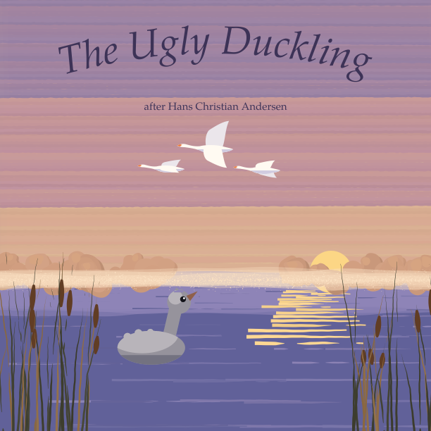
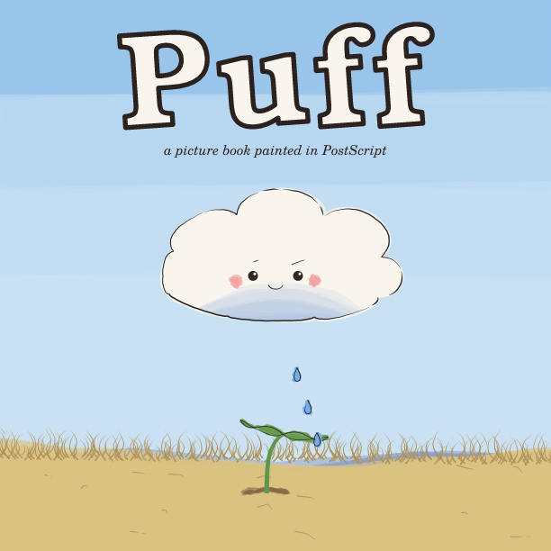
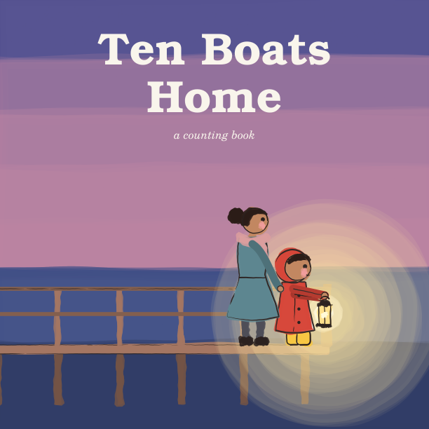

# childrens_book

Picture books written, illustrated and typeset entirely in PostScript, and
rendered with [pscat](https://github.com/PSCatLabs/pscat) into print-ready
PDFs. An [ArtColony](https://github.com/ArtColony) project, and an
experiment in **making long creative artifacts in explicit stages**:
ideation → manuscript → storyboard → book → reflection, each with a
checkpoint and a review panel of persona agents.

**Site:** <https://artcolony.github.io/childrens_book/>: the books, the
process, every stage document and every review.

| | Book | |
|---|---|---|
|  | **[The Ugly Duckling](books/the-ugly-duckling/)**: Andersen's tale, retold from a public-domain edition and painted with no ink lines, through four seasons. The art came first: three style studies before a word was set. [PDF](books/the-ugly-duckling/the-ugly-duckling.pdf) | |
|  | **[Puff](books/puff/)**: the smallest cloud is told she's too small to rain, until a seedling needs her. An explicit-message book, with words laid out to move with the pictures. [PDF](books/puff/puff.pdf) | |
|  | **[Ten Boats Home](books/ten-boats-home/)**: a counting book. Ana counts the fishing boats home, and the tenth is fog. Made with every stage and panel. [PDF](books/ten-boats-home/ten-boats-home.pdf) | |
|  | **[Moss Goes to the Sea](books/moss-goes-to-the-sea/)**: a small snail goes, slowly, to hear the sea sing. Made before the process existed; [its reflection](books/moss-goes-to-the-sea/05-reflection.md) says what that cost. [PDF](books/moss-goes-to-the-sea/moss-goes-to-the-sea.pdf) | |

**[The process](docs/process.md)**: the stages, their checkpoints, the
"heart" that runs through them, and the review panel.

## How it's made

Every page is a short PostScript program in `book/`. Nothing is drawn by hand
or imported, and there are no bitmaps. The pictures come from pscat's
painting library (`lib/paintkit.ps`), wrapped in a small house style:

- **Watercolour.** `pkwash` lays translucent, wobble-edged washes with a
  darker rim where the pigment pools. `pkpaper` is the paper grain under
  every page.
- **Ink.** `pkliner`, a flexible brush that wanders slightly off its path and
  tapers, outlines everything near the eye.
- **Grass, rain and stars.** `pkpull` pushes up grass blades. `scatter`
  places raindrops and stars.
- **Moss.** She is one procedure, `cb-moss` in `lib/cb_moss.ps`, with a few
  options: which way she faces, eyes open, closed or looking up, tucked into
  her shell, and how long a silver trail she leaves. That keeps her the same
  snail on every page.
- **Type.** New Century Schoolbook, a classic picture-book face and one of
  the standard 35 PostScript fonts. A small word-wrapper (`cb-text`) sets it
  with curly quotes.

`scripts/book.sh` runs every page inside its own `save … restore` and has
pscat write them as one multi-page PDF. The PDF keeps real transparency for
the washes. The text is drawn as vector outlines, so it prints sharply but
can't be searched; see `docs/pscat-issues.md`.

## Setup

This repo uses the **released** pscat at the version pinned in
`.pscat-version` (a 0.7 release candidate, like the other ArtColony
projects). Install it from the
[releases page](https://github.com/PSCatLabs/pscat/releases):

```sh
v=$(cat .pscat-version)
t=aarch64-apple-darwin          # or x86_64-apple-darwin, x86_64-unknown-linux-musl, ...
gh release download "v$v" -R PSCatLabs/pscat -p "pscat-$v-$t.tar.gz" -p SHA256SUMS
shasum -a 256 -c SHA256SUMS --ignore-missing
tar xzf "pscat-$v-$t.tar.gz"
# keep the bundle together and put pscat and pscat-mcp on your PATH
pscat --version
```

## Building the book

```sh
scripts/book.sh                              # the whole book -> renders/moss-goes-to-the-sea.pdf
scripts/book.sh moss-goes-to-the-sea.pdf     # refresh the committed copy
scripts/render.sh                            # every page as a PNG -> renders/
DPI=144 scripts/render.sh book/01_home.ps    # one page at 2x
scripts/render.sh -D Seed=4 book/07_rain.ps  # another seed: different brush wobble, rain
scripts/render.sh --sweep-seed 1:9 book/07_rain.ps   # contact sheet of seeds
```

The whole book binds in a few seconds. Renders go to `renders/` (git-ignored),
or to `$CB_RENDERS` when that's set. Every run is strictly linted: an error, or
a leaked stack item or `gsave`, fails it.

## Layout

| Path | What |
|---|---|
| `book/NN_name.ps` | One file per page, in reading order: `00_cover` … `14_the_end` |
| `lib/cb_book.ps` | What every page loads: artkit, paintkit and the three `cb_` libraries |
| `lib/cb_kit.ps` | House style: trim size, palette, `cb-wash` / `cb-bigwash` / `cb-line`, `cb-text` (wrapped type), `cb-folio`, `cb-local` |
| `lib/cb_moss.ps` | `cb-moss`: the hero, with options `cb-face`, `cb-eyes`, `cb-tuck`, `cb-trail` |
| `lib/cb_world.ps` | Scenery: sky, hills, grass, flowers, leaves, cabbages, clouds, sun, moon, stars, gull, ladybird, fence, rain, sea, waves |
| `scripts/render.sh` | Render pages to PNG with strict lint and timing; `-D Name=value`, `--sweep-seed` |
| `scripts/book.sh` | Bind all pages into one PDF and check the page count |
| `moss-goes-to-the-sea.pdf` | The finished book |
| `previews/` | Chosen page renders for this README |
| `docs/pscat-issues.md` | pscat bugs and surprises met along the way |

## Licence

[CC0 1.0](LICENSE): the story, pictures and code are in the public domain.
