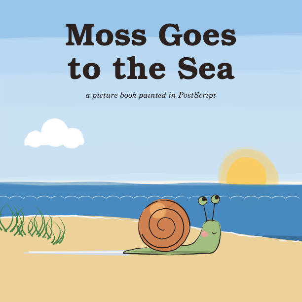
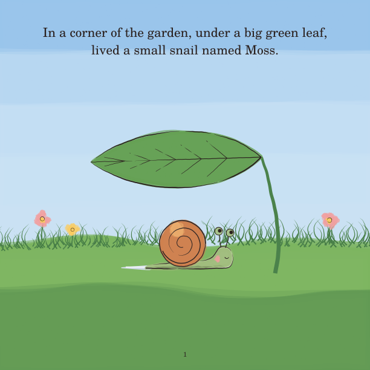
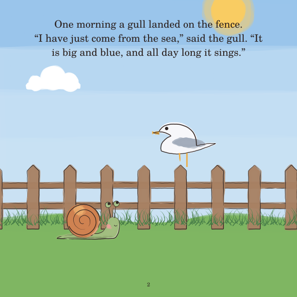
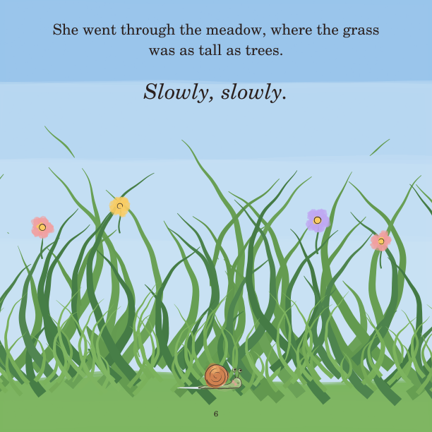
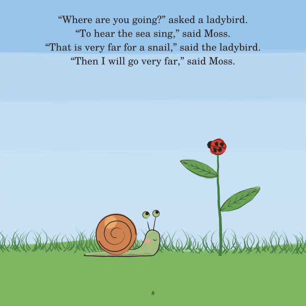
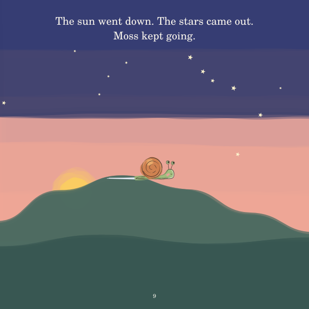
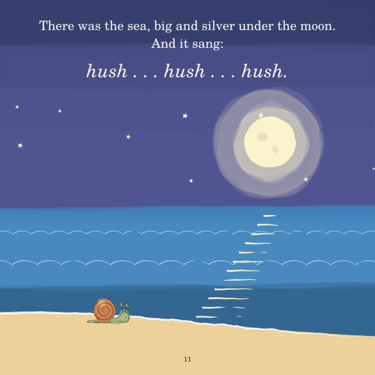

# Moss Goes to the Sea

*A small snail hears that the sea sings, and goes, slowly, to hear it.*

**[Read the book (PDF)](moss-goes-to-the-sea.pdf)**: 15 pages, 8.5 × 8.5 in.

The first book in this repo. It was made before the [staged
process](../../docs/process.md) existed: it had one concept, no named heart
and no storyboard. Its [reflection](05-reflection.md) is a meta-analysis of
what the finished book means, and of what the skipped stages cost.

| | | |
|---|---|---|
|  |  |  |
|  |  |  |

## The story

> **1.** In a corner of the garden, under a big green leaf, lived a small snail named Moss.
>
> **2.** One morning a gull landed on the fence. "I have just come from the sea," said the gull. "It is big and blue, and all day long it sings."
>
> **3.** "I would like to hear the sea sing," said Moss. So she packed nothing at all, because a snail carries her house with her, and off she went.
>
> **4.** She went past the cabbages. *Slowly.*
>
> **5.** She went under the gate. *Slowly.*
>
> **6.** She went through the meadow, where the grass was as tall as trees. *Slowly, slowly.*
>
> **7.** Then it began to rain. Moss did not mind one bit. Snails like rain.
>
> **8.** "Where are you going?" asked a ladybird. "To hear the sea sing," said Moss. "That is very far for a snail," said the ladybird. "Then I will go very far," said Moss.
>
> **9.** The sun went down. The stars came out. Moss kept going.
>
> **10.** At last the grass turned to sand, and the sand ran all the way down to the water.
>
> **11.** There was the sea, big and silver under the moon. And it sang: *hush . . . hush . . . hush.*
>
> **12.** Moss listened until her eyes grew heavy.
>
> **13.** Then she curled up inside her shell, the way snails do. And there, in her own small house, she could still hear the sea singing: *hush . . . hush . . . hush.*
>
> *The End*

## Files

| Stage | File |
|---|---|
| 1 Ideation | *(skipped: a single concept, chosen for drawability)* |
| 2 Manuscript | the story above, written straight onto the pages |
| 3 Storyboard | *(skipped)* |
| 4 Book | [`pages/`](pages/), bound into [`moss-goes-to-the-sea.pdf`](moss-goes-to-the-sea.pdf) |
| 5 Reflection | [`05-reflection.md`](05-reflection.md) |
