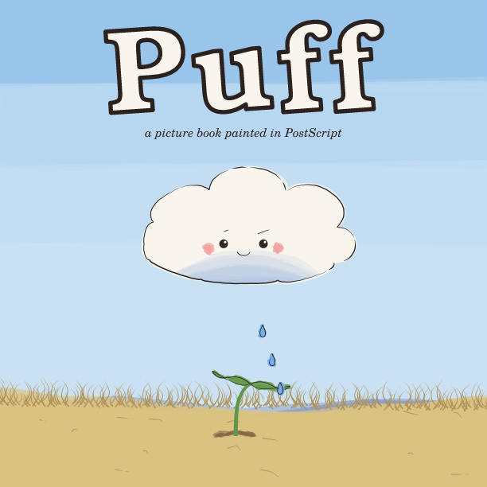
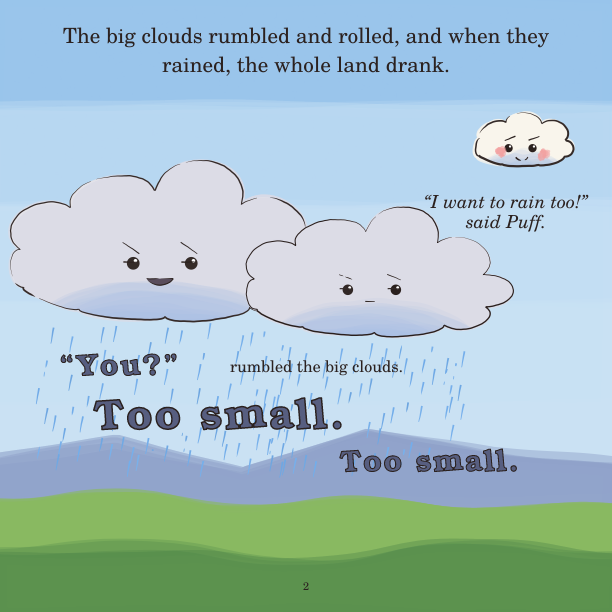
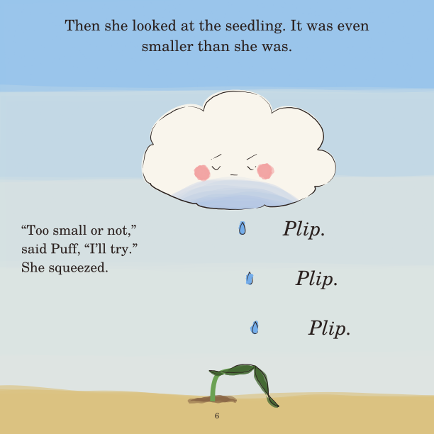
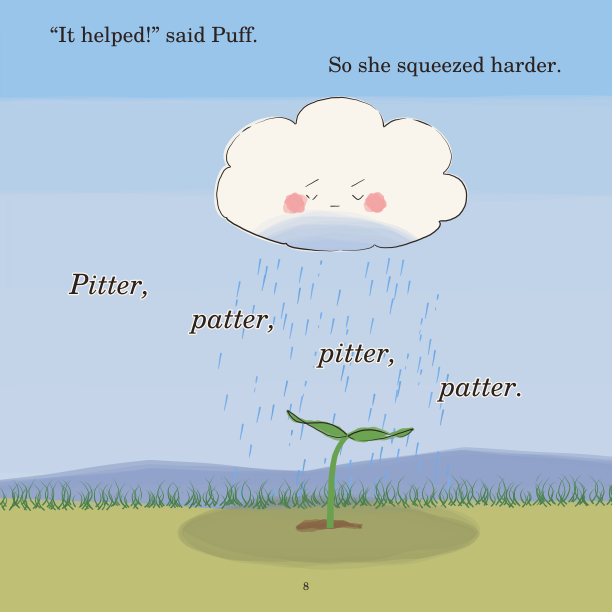
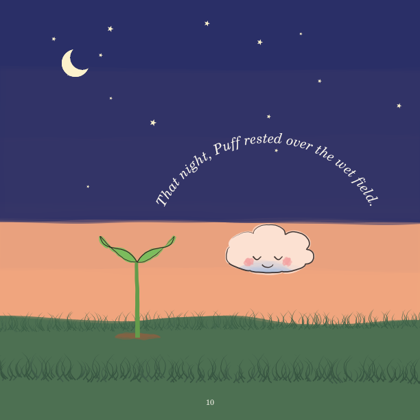
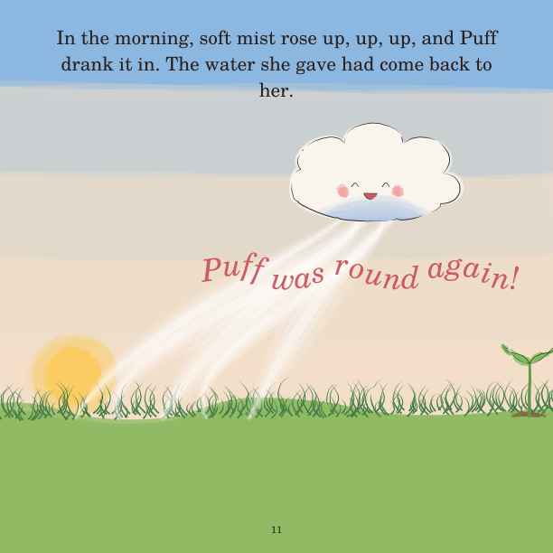
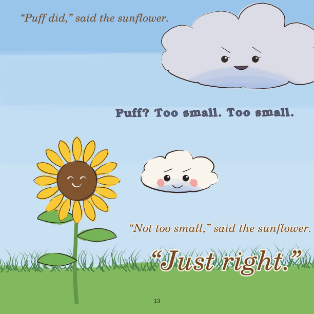

# Puff

*The smallest cloud in the sky is told she's too small to rain, until a
seedling in a dry field needs her.*

**[Read the book (PDF)](puff.pdf)**: 16 pages, 8.5 × 8.5 in, ages 3–6.

The third book in this repo, made after a human reader's feedback on the
first two:

- ***Ten Boats Home* was too subtle.** Its message was only acted, never
  said, and our reader didn't get it. *Puff* is an
  [explicit-message book](../../docs/process.md#explicit-message-books):
  the lesson is said in plain words, *"No one is too small to help,"* by
  the big clouds who were wrong.
- ***Moss*'s art was liked better**: a simple, limbless hero in a big
  painted landscape. Puff is a cloud with a face, and every page is mostly
  sky.
- **"Be more creative with the layout of text and images."** The words
  move with the pictures:
  - the *plips* fall with the drops, and *pitter, patter* steps down
    through the rain;
  - "whole big sky." is set huge, and a whisper is set small;
  - the night line curves over the sleeping cloud, and "The End" arcs
    across the rainbow.
  - Each voice has its own type: the narrator in roman, Puff in italic, the
    sunflower in warm brown, and the big clouds in heavy, wobbling
    capitals.

| Stage | Document | What happened |
|---|---|---|
| 1 Ideation | [01-ideation.md](01-ideation.md) | Three concepts. The editor named the nearest comparable (*Cloudette*), and the book claims its own turn: Puff is used up and comes back. Hero sheet: [seven moods with no arms or legs](hero_sheet.png) |
| 2 Manuscript | [02-manuscript.md](02-manuscript.md) | The gate is that cold readers can say the lesson back. A child said *"Even if you're little, you can still help."* One fixed refrain, *"Too small. Too small."*; an apology to Puff |
| 3–4 Book | [`pages/`](pages/), [`puff.pdf`](puff.pdf) | Painted directly (each page renders in about a second), and reviewed as a sequence on a [contact sheet](sheet.png). Two panel rounds, then the type layout, then Codex |
| 5 Reflection | [05-reflection.md](05-reflection.md) | What it says, what the reader asked for, and what still holds it back |

Every decision is in [checkpoints.md](checkpoints.md), and every review is
in [`reviews/`](reviews/).

| | | |
|---|---|---|
|  |  |  |
|  |  |  |

## The story

> **1.** Puff was a little cloud. She was the smallest cloud in the whole
> big sky.
>
> **2.** The big clouds rumbled and rolled, and when they rained, the whole
> land drank. "I want to rain too!" said Puff. "You?" rumbled the big
> clouds. "Too small. Too small."
>
> **3.** Off they rolled to the far mountains. Puff puffed and puffed, but
> she could not keep up. The sun grew hot.
>
> **4.** Down in a dry field stood one little seedling. Its leaves hung
> down. "Water," it whispered. "Please."
>
> **5.** Puff was the only cloud in the sky. "Too small," thought Puff.
> "Too small."
>
> **6.** Then she looked at the seedling. It was even smaller than she was.
> "Too small or not," said Puff, "I'll try." She squeezed. *Plip. Plip.
> Plip.*
>
> **7.** And one little leaf lifted up.
>
> **8.** "It helped!" said Puff. So she squeezed harder. *Pitter, patter,
> pitter, patter.*
>
> **9.** Puff rained until the seedling stood up tall. She was thin now,
> and sleepy. But she was smiling.
>
> **10.** That night, Puff rested over the wet field.
>
> **11.** In the morning, soft mist rose up, up, up, and Puff drank it in.
> The water she gave had come back to her. Puff was round again!
>
> **12.** Weeks went by. The little seedling grew and grew. Then the big
> clouds came rolling home. "Who watered you?" they rumbled.
>
> **13.** "Puff did," said the sunflower. "Puff?" rumbled the big clouds.
> "Too small. Too small." "Not too small," said the sunflower. "*Just
> right.*"
>
> **14.** "We were wrong," rumbled the big clouds. "Sorry, Puff. No one is
> too small to help. Come and rain with us!" And they made room for her,
> right in the middle.

*(The last page has no words: Puff rains with the big clouds over the green
field, under a rainbow.)*
