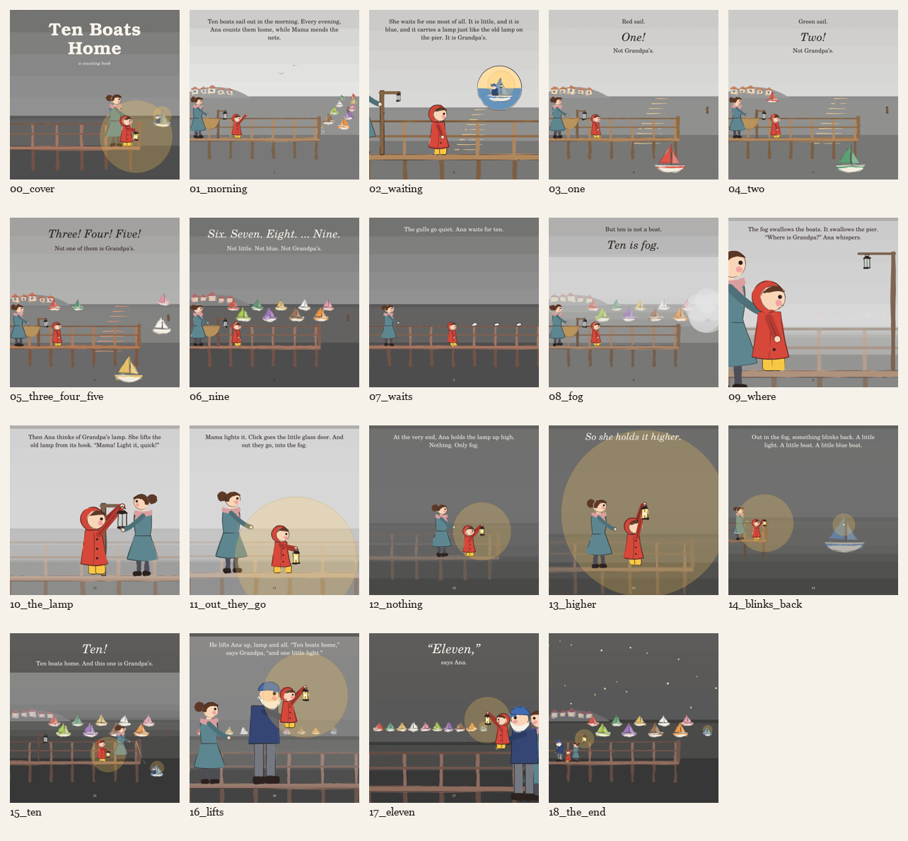

# Stage 3: Storyboard



## How the storyboard is made

**Each page has one source file.** `pages/NN_name.ps` is both the
storyboard thumbnail and the finished page. The thumbnail is the page run in
**rough mode** (`03-storyboard/NN_name.ps` sets `/cb-rough true` and runs
it):

- the big watercolour washes (sky, sea, hills, fog) become flat translucent
  greys at their real lightness, so composition and value read without paint;
- the lamp's glow becomes a translucent gold disc with a dashed rim, showing
  how far the light will reach without hiding what is under it;
- characters, boats and sails stay in colour, because the counting depends on
  the sails;
- the text is the real manuscript text, set with `cb-text`, so line breaks,
  fit and widows are real now.

That makes checkpoint 4's "each painted page matches its thumbnail" true by
construction. Painting changes how a page is rendered, not where things are.

```sh
scripts/render.sh books/ten-boats-home/03-storyboard
scripts/sheet.py renders/ten-boats-home/03-storyboard storyboard_sheet.png --cols 5
```

**Pages 1–8, 15 and the end page share one camera, the harbour view.** It
has one horizon, one pier, the same moorings filling up one by one, and an
empty post (`cb-tenth`) waiting for the tenth boat. A child can find each
returning boat in the same place on every later page.

## Round 1, the first render: what the sequence showed

Looking at all 19 thumbnails together caught problems that no single page
showed:

| Problem | Fix |
|---|---|
| In rough mode the glow and the fog were opaque grey discs and bands: the night pages showed nothing but grey | Rough masses are translucent (`setalpha`) at the colour's real lightness; the glow becomes a dashed disc |
| Night text (cream) was unreadable on a pale rough sky, so legibility couldn't be judged | Rough greys use the colour's real lightness, so night pages are dark |
| p2's memory inset was empty: a second call painted paper over the boat | The rim is drawn without a fill |
| Ana's raised arm crossed her face, which was fine at 100 pt but ugly in the p17 close-up | The raised arm starts at the near shoulder, and the hand moves forward to (0.36, 0.86) of her height |
| p1's ten boats were bunched in a corner, too small to count | They are strung in one long line from the pier's end to the horizon |

## Author's checklist (round 1, before the panel)

- [x] Text and picture agree on every page: each page shows its plan's drawable moment.
- [x] The text band is clear: no mark crosses the top 130 pt on any page.
- [ ] **Shot distance varies**, no more than three of the same in a row. **Fails:**
      pp. 3–8 are all the same wide harbour view (six in a row). This is
      deliberate for counting continuity, but it breaks the rule. **Panel
      to judge.**
- [x] Continuity: boats sail ← home, Ana faces → out to sea, the walk home
      goes ←; light moves only forward (morning, gold, sunset, dusk, fog,
      night).
- [x] The lamp is on its hook on pp. 1–9, in Ana's hands on pp. 10–17,
      and back on its hook on the end page.
- [ ] Mama in frame on every fog and night page. **Fails on p9** (the
      close-up): she is out of frame to the left.
- [x] The tenth mooring is empty on pp. 1–8, fog stands there on p8, and
      the little blue boat is in it on the end page.
- [x] p13 has the book's biggest light.
- [x] The hero is recognisable on every thumbnail at contact-sheet size.

## Panel and round 2

The artist, educator and child each reviewed round 1 (see [`reviews/`](reviews/)).
Their verdict was "revise before painting", and 17 points were fixed in
round 2, the sheet above. Each one is logged in
[checkpoints.md](checkpoints.md#checkpoint-3-storyboard).

The most important was **"Eleven"**. A five-year-old asked "Who is the
eleven?", and nothing on the page answered. The words didn't change. The
picture did: ten boats in a row, and the lamp at the end of it.
