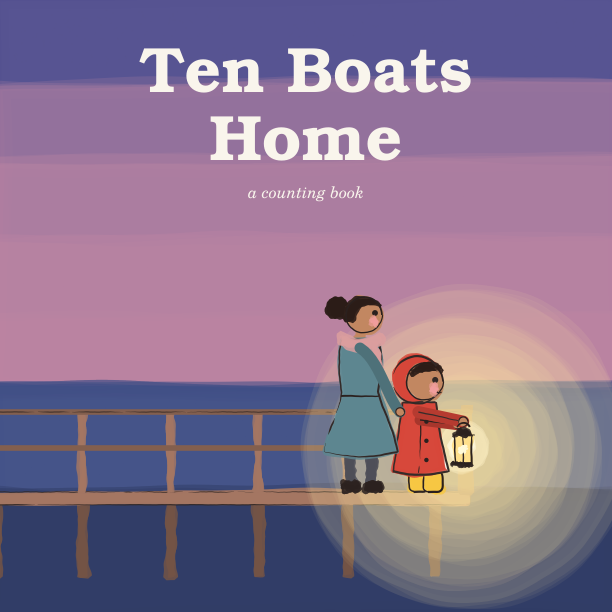
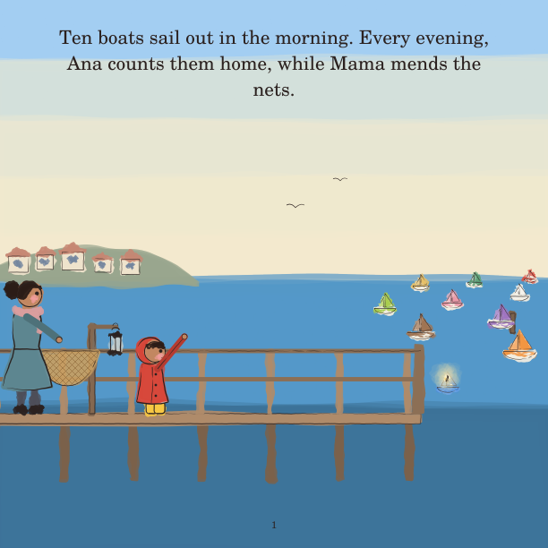
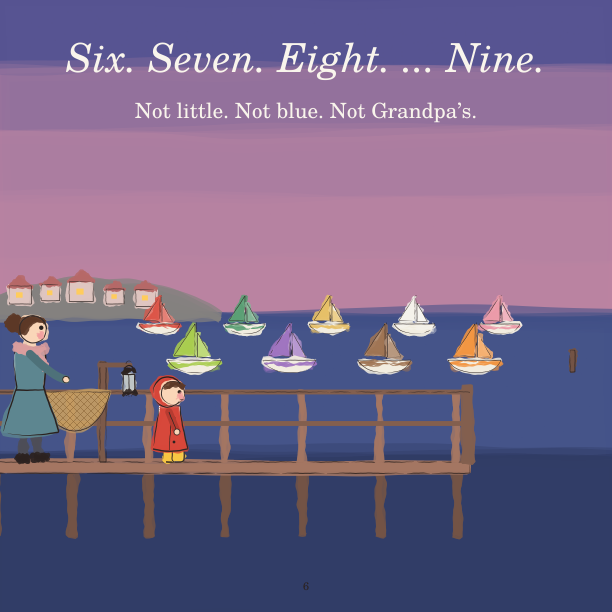
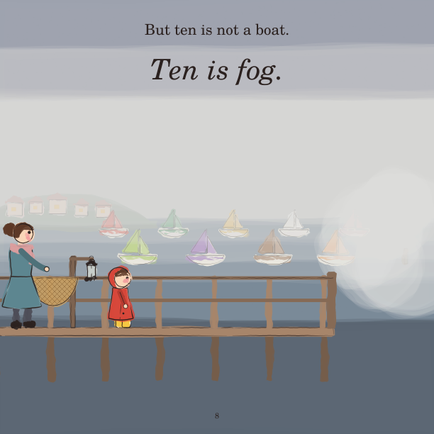
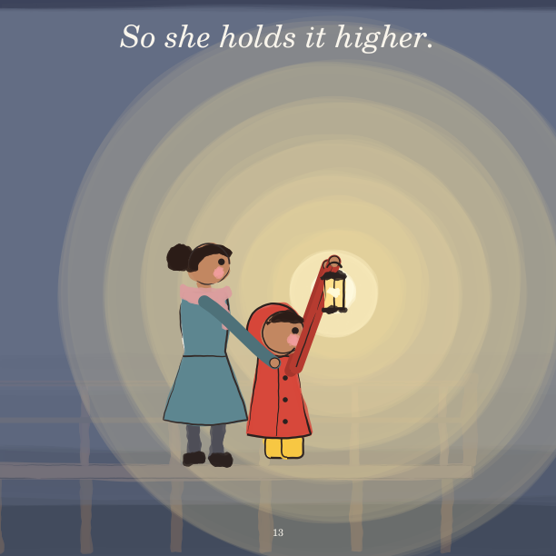
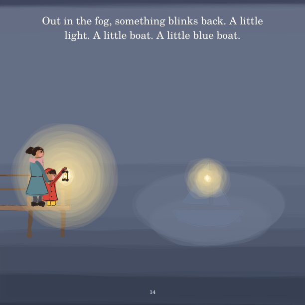
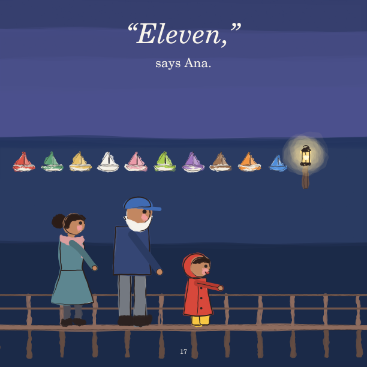

# Ten Boats Home

*Ana counts the fishing boats home every evening. Tonight nine come in,
and the tenth is fog.*

**[Read the book (PDF)](ten-boats-home.pdf)**: 19 pages, 8.5 × 8.5 in, a
counting book for ages 3–6.

The second book in this repo, and the first made with every stage of
[the process](../../docs/process.md), each with its own review panel: a
child, a parent, an early-childhood educator, a picture-book editor and an
art director, all played by agents. Follow it stage by stage:

| Stage | Document | What happened |
|---|---|---|
| 1 Ideation | [01-ideation.md](01-ideation.md) | Three concepts, scored against criteria written first. The story's *heart* is named, along with what it must not say. The cast is proved on a [hero sheet](hero_sheet.png) |
| 2 Manuscript | [02-manuscript.md](02-manuscript.md) | Three drafts and two panels. The editor's score went 5 → 6.5, the count was given its full run, and the ending became *"Eleven," says Ana* |
| 3 Storyboard | [03-storyboard.md](03-storyboard.md) | Thumbnails with the real text. A five-year-old asked "Who is the eleven?", and the picture now answers |
| 4 Book | [`pages/`](pages/), [`ten-boats-home.pdf`](ten-boats-home.pdf) | Painted from the storyboard: one source file per page, rough or painted |
| 5 Reflection | [05-reflection.md](05-reflection.md) | What the finished book says, read cold |

Every decision is in [checkpoints.md](checkpoints.md), and every review in
[`reviews/`](reviews/).

| | | |
|---|---|---|
|  |  |  |
|  |  |  |

## The story

> **1.** Ten boats sail out in the morning. Every evening, Ana counts them home, while Mama mends the nets.
>
> **2.** Most of all, she waits for Grandpa's boat. It is little. It is blue. And it carries a lamp, just like the old lamp on the pier.
>
> **3.** Red sail. *One!* Not Grandpa's.
>
> **4.** Green sail. *Two!* Not Grandpa's.
>
> **5.** *Three! Four! Five!* Not one of them is Grandpa's.
>
> **6.** *Six. Seven. Eight.* … *Nine.* Not little. Not blue. Not Grandpa's.
>
> **7.** The gulls go quiet. Ana waits for ten.
>
> **8.** But ten is not a boat. Ten is fog.
>
> **9.** The fog swallows the boats. It swallows the pier. "Where is Grandpa?" Ana whispers.
>
> **10.** Ana looks up at the old lamp. She lifts it from its hook. "Mama! Light it, quick!"
>
> **11.** Mama lights it. *Click!* And out they go, into the fog.
>
> **12.** At the very end, Ana holds the lamp up high. Nothing. Only fog.
>
> **13.** So she holds it higher.
>
> **14.** Out in the fog, something blinks back. A little light. A little boat. A little *blue* boat.
>
> **15.** *Ten!* Little. Blue. *Grandpa's.*
>
> **16.** Grandpa lifts Ana up. "I saw your light," he says. "Ten boats home."
>
> **17.** "*Eleven*," says Ana.
