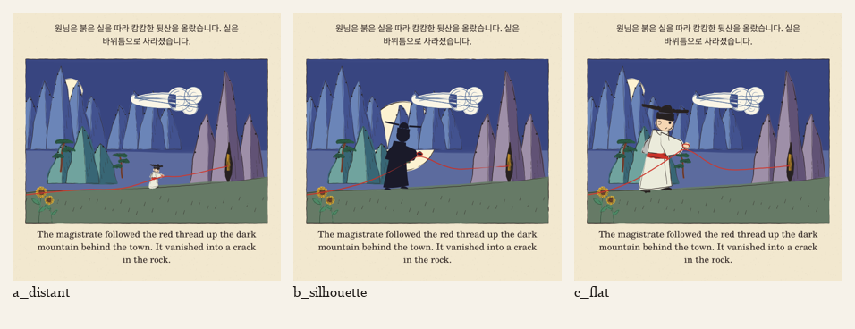
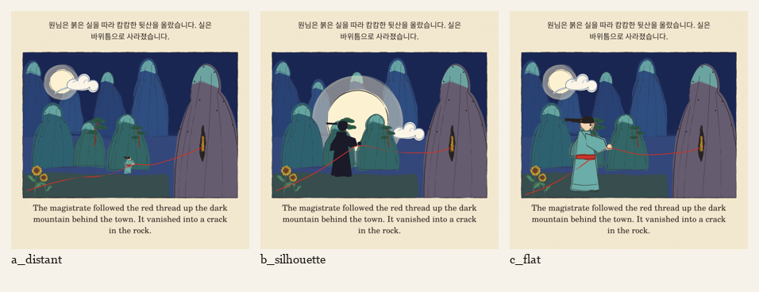

# Stage 1b: Style

*This book has to paint people, which the reader disliked in* Ten Boats
Home*, so the style study tests figures first. One scene was painted three
ways: the night the magistrate follows the red thread up the mountain to the
crack in the rock. The layout is fixed by the reader: Korean in the top band,
English in the bottom band, and the painting in a framed panel between them.*

*The first pass, which the art director reviewed:*

| Study | The figure | Strongest | Weakest |
|---|---|---|---|
| **A**, distant | Small, flat, in a big landscape | Scale and loneliness | A speck: no face, no gesture. Can't carry a mother with a baby, a boy writing or a wedding |
| **B**, silhouette | One dark shape against a big moon | The clearest image at a glance | Hides faces; needs a bright moon behind every figure |
| **C**, flat minhwa | Large: colour inside an ink line, no modelled anatomy | The only one that scales to faces, hands, a baby, wedding robes. Closest to real minhwa figures | Stiff: a signpost pose, a wrong putou hat, a small blank face, the robe the same value as the hills |

**Chosen: a hybrid built on C.** People are flat minhwa figures at about a
third of the panel's height. A's small figures are kept for the wide, lonely
beats (the abandoned baby on the shore, the exile, the walk into Mount
Gaya), and B's silhouette is used once or twice where a moon stands behind
someone. That is the art director's pick ([review](reviews/01-style-artist.md),
C 6/10 as drawn, the hybrid up to 8 with fixes).

The same review found the landscape **"generic night fantasy, not minhwa"**.
The figure is a drawing problem; the landscape is a style problem, and it
sinks the book if it isn't fixed. So the hero sheet starts with it.

## The rules of the look

- **Ground and colour.** Warm hanji paper (`cb-mh-ground`) and bright mineral
  colour in blocks: the obangsaek (`cb-mh-blue`, `-red`, `-yellow`, `-white`,
  `-black`) and the in-between colours. Night is a **lighter indigo wash** on
  the warm ground, not a navy field.
- **Ink line on everything.** `cb-line` round every shape, as minhwa does:
  colour sits inside a lively contour.
- **Mountains are angular crags**, stacked and faceted, with ink texture
  strokes (준법) and moss dots (태점), in the manner of *Irworobongdo* and the
  Geumgangsan screens. No rounded gumdrops.
- **Clouds are sangseo-un** (상서운): flat, curled, auspicious bands in white,
  blue and red, never puffs.
- **The moon and the sun are flat discs** with a crisp ring, white or red. No
  glow.
- **Pines** are twisted red-brown trunks with layered flat tufts.
- **Pattern in the mid-ground:** scale-pattern waves, rock strokes, and
  dancheong and jogakbo where buildings and cloth appear.
- **Gold is the one accent:** the pig, then the sunflowers.
- **Figures:** flat robes inside ink line, a head about 1/6 of the body,
  faces with a brow and a gaze that points where the story goes, poses that
  lean and step. Every figure must separate from its ground by value.
- **The frame:** a paper mat with a thin double rule. Pines, cloud tails or
  the thread may break it into the margin, once a page at most. The panel
  height varies with the scene (tall for mountains, wide for the town), and
  the climax (the box) goes full-bleed.
- **Type:** English in NewCenturySchlbk, Korean in NotoSansKR. Korean sets a
  little larger than English, to match its optical weight. The art director
  asked for a serif Korean face to match the English; the font pack has
  none, so this is logged as a decision. The gaps above and below the panel
  are balanced.

## The second pass

Applied to the same scene:
- **Mountains:** built from angular spires (`cb-mh-spire`, `cb-mh-crag`), each
  with a lit facet, a shadow facet, a ridge, texture strokes and moss dots.
  Reshaping one rounded outline three times had still given gumdrops; a
  new construction fixed it.
- **Sky and ground:** a lighter indigo wash on the warm ground, and a
  hillside in place of the slab.
- **Moon and cloud:** a flat moon with a crisp ring, and a sangseo-un cloud
  with curled lobes. The cloud is still stripy along its tail and gets
  another pass on the hero sheet.
- **The figure:** a three-quarter view with a two-tier putou and thin wings
  set high, a bigger face with a raised brow and a gaze, a forward lean and
  an uphill step, and the thread wound round his hand. A pale robe
  separates him from the night.
- **Type, measured:** a 35-word page fits 3 Korean lines at 20 pt and 4
  English lines at 19 pt. The panel now runs from y 150 to 476.

## Next

The hero sheet starts with **the golden pig**: the title character and the
book's only gold, not yet drawn. Then the people in these files:

- `lib/cb_chiwon.ps`: the magistrate, the wife, the boy at each age;
- `lib/cb_goldpig.ps`: the pig, the cave, the thread, the box;
- `lib/cb_minhwa.ps`: crags, sangseo-un, the moon, pines, waves, sunflowers,
  borders.
