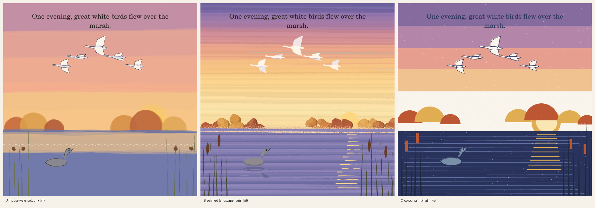
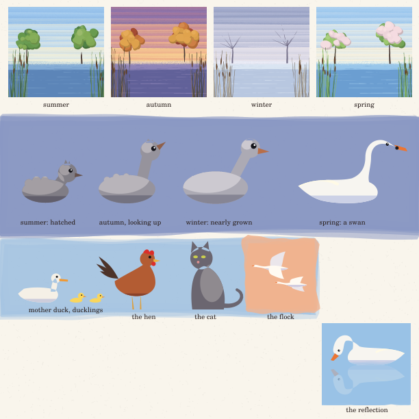

# Stage 1b: Style

*This book's art is the point, so the look was chosen before a word of the
retelling was set. Three studies were made of one key scene: the autumn
dusk when the swans fly south and the grey duckling watches from the
reeds.*

| Study | What it is | Strongest | Weakest |
|---|---|---|---|
| **A**, the house style | `cb_kit` watercolour washes and ink line, as in *Moss* and *Puff* | Friendly and cohesive | The water is a flat slab; the trees are blobs; the hard ink duckling clashes with soft washes |
| **B**, painted landscape | paintkit's broad loaded brushes over a wash underpainting, dabbed trees, sprayed mist and glints on the water. **No ink lines**: form comes from colour and light | The dusk light, the glitter path and the texture of water and sky | At first the trees read as rocks, the duckling as a plain lozenge, and the horizon cut hard |
| **C**, colour print | five flat inks, slightly off register, paper grain showing through | The boldest design and the best colour rhythm | Too heavy and too mechanical over 16 pages. It can't do mist or ice, which winter needs |

**Chosen: B, with C's discipline.** We keep B's light and texture, and take
from C fewer, bolder shapes and a clear structure of three values. That was
the art director's pick ([review](reviews/01-style-artist.md)), agreed by
the advisor.

## The rules of the look

- **No outlines.** Every shape is a union of flat fills, lit from the upper
  left: a base colour, a lit top clipped to the shape, a cool underside,
  and a warm rim of light on the back.
- **The horizon is low,** because the sky is the star. The sky is painted
  in broad graded strokes over a wash, and its top band stays quiet for
  type.
- **The water reflects the sky.** Ripples are short at the horizon and long
  toward us, and the sun leaves a path of glints.
- **A dark frame of reeds** stands at the page edges, overlapping and
  swaying, with cattails.
- **One warm accent per page:** the sun, a beak, a leaf.
- **Seasons are palette swaps, not new drawings.** `cb-season` picks
  `/summer`, `/autumn`, `/winter` or `/spring` from one table in
  `lib/cb_marsh.ps`, and every scenery procedure reads it. The structure
  stays, and only the colours change. Winter takes almost all the warmth
  out, so the loneliness reads.

## The hero sheet

The advisor set two tests for the sheet:

1. **The transformation has to read as one bird growing,** not a grey
   drawing swapped for a white one. `cb-duckling` takes a growth setting,
   `cb-dkgrow` from 0 to 1. As it rises, the neck lengthens, the head
   shrinks, the tuft and fluff fade, the grey lightens and the beak warms
   toward orange. The swan keeps his catch-light eye. The test is a fresh
   child agent shown only the [growth row](01-hero/growth_row.png),
   asked "Is it the same bird?" It answered: *"It's the same bird, getting
   bigger! Its neck gets longer and its feathers go from grey to white."*
   **Passed.**
2. **The figures with legs have to hold up.** These are the hen and the
   cat, where *Ten Boats Home*'s figures failed. As flat lit shapes (a hen
   in profile, a cat sitting) they do. **Passed.** The cottage scene stays.
