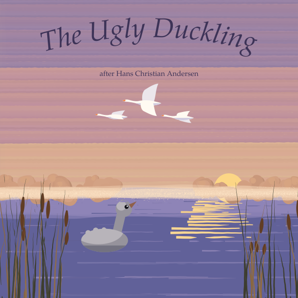
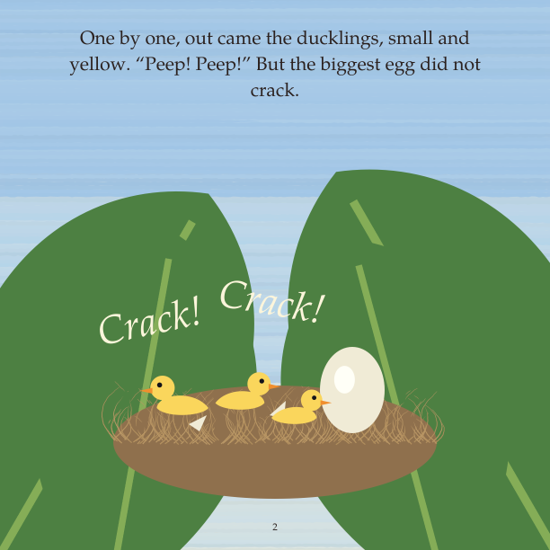
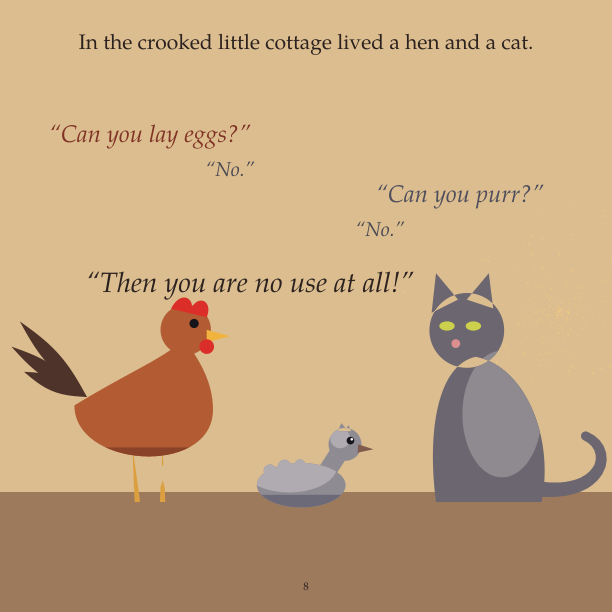
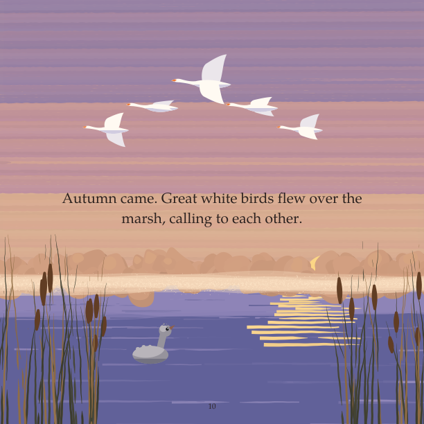
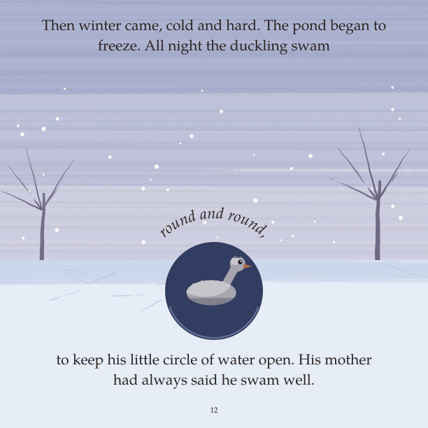
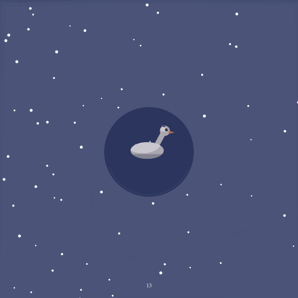
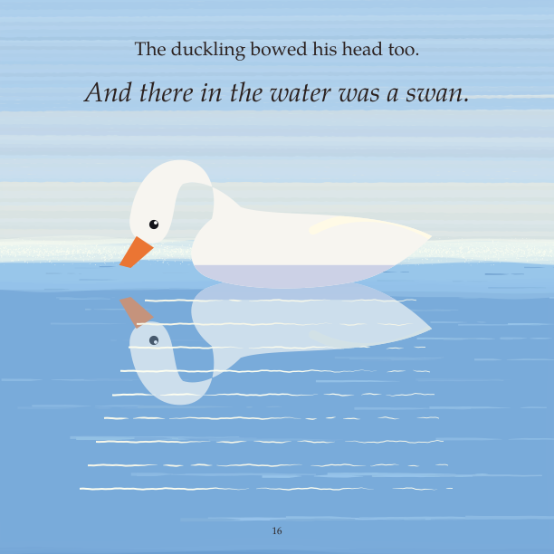

# The Ugly Duckling

*Hans Christian Andersen's tale, retold and painted: a grey bird, mocked in
the duck yard, survives a winter alone and finds in spring that he has been
growing all along.*

**[Read the book (PDF)](the-ugly-duckling.pdf)**: 19 pages, 8.5 × 8.5 in, ages 3–6.

> **Status: finished, first painted edition.** All five stages are done. The
> finished-book review (artist, a cold child, a cold adult, and a Claude code
> review standing in for Codex) is in [checkpoint 4](checkpoints.md), and the
> [reflection](05-reflection.md) lists what a second painting pass would do.

The fourth book in this repo, and an experiment in **separating the art
from the storytelling**. The story already exists (a public-domain 1886
English edition; see the [interpretation](01-interpretation.md)), so the
stages went into the look:

- three style studies of one scene;
- a painted style with no ink lines;
- seasons as palette swaps;
- a hero who visibly grows from page to page.

| Stage | Document | What happened |
|---|---|---|
| 1 Interpretation | [01-interpretation.md](01-interpretation.md) | Why this tale (the medium paints birds, water and seasons well), what we keep, and what we cut: Andersen's "hatched from a swan's egg" ending, which says worth comes from birth |
| 1b Style | [01-style.md](01-style.md) | Three looks of the autumn flock scene. **Painted** won. The [hero sheet](hero_sheet.png) proves the duckling reads as one bird growing |
| 2 Retelling | [02-manuscript.md](02-manuscript.md) | Our wording, with three pages left wordless. The parent and the editor disagreed about the last line; the ending is now about belonging, not beauty |
| 3–4 Book | [`pages/`](pages/), [`the-ugly-duckling.pdf`](the-ugly-duckling.pdf) | Painted directly and reviewed on a [contact sheet](sheet.png) |
| 5 Reflection | [05-reflection.md](05-reflection.md) | Every reader heard "different, and growing"; the art scored 7/10, best on the wordless pages |

Every decision is in [checkpoints.md](checkpoints.md), and every review is
in [`reviews/`](reviews/).

| | | |
|---|---|---|
|  |  |  |
|  |  |  |

## The story

> **1.** It was summer in the country. Down by the old farm, a mother duck
> sat on her nest.
>
> **2.** *Crack! Crack!* One by one, out came the ducklings, small and
> yellow. "Peep! Peep!" But the biggest egg did not crack.
>
> **3.** At last it did. Out tumbled a duckling who was big, and grey, and
> not like the others at all. "Never mind," said his mother. "Look how well
> he swims."
>
> **4.** But in the duck yard, the ducks pecked him and the hens chased
> him. "How big and ugly he is!" they said.
>
> **5.** His mother hushed them, but they would not stop. So one morning the
> grey duckling ran away, under the hedge and out into the wide marsh.
>
> **6.** The wild ducks looked at him. "You are very ugly," they said. "But
> you may stay, if you keep out of the way." So he hid in the reeds, all
> alone.
>
> **7.** *(no words: a storm at dusk, and a crooked little cottage with one
> lit window)*
>
> **8.** In the crooked little cottage lived a hen and a cat. "Can you lay
> eggs?" asked the hen. "No." "Can you purr?" asked the cat. "No." "Then you
> are no use at all!"
>
> **9.** "But I love to swim," said the duckling, "and to dive to the bottom
> of the water." "What nonsense!" said the hen. So the duckling went back
> out into the wide world.
>
> **10.** Autumn came. Great white birds flew over the marsh, calling to
> each other.
>
> **11.** The duckling did not know their name. But he stretched his neck
> after them, and he loved them, more than he had ever loved anything.
>
> **12.** Then winter came, cold and hard. The pond began to freeze. All
> night the duckling swam round and round, to keep his little circle of
> water open. His mother had always said he swam well.
>
> **13.** *(no words: a small dark circle of water in the white ice, the
> duckling swimming in it, snow falling)*
>
> **14.** Spring came. The duckling spread his wings, and up he flew.
>
> **15.** There on the water were three white swans. "They will chase me
> away," he thought. But the swans swam to meet him, and they bowed their
> heads. "Welcome," they said.
>
> **16.** The duckling bowed his head too. And there in the water was a
> swan.
>
> **17.** The young swan whispered, "When I was the ugly duckling, I never
> dreamed of such happiness." "You were never ugly," said the swans. "You
> were different. And you were still growing. Come, swim with us."

*(The last page has no words: four swans fly together over the spring
marsh.)*
